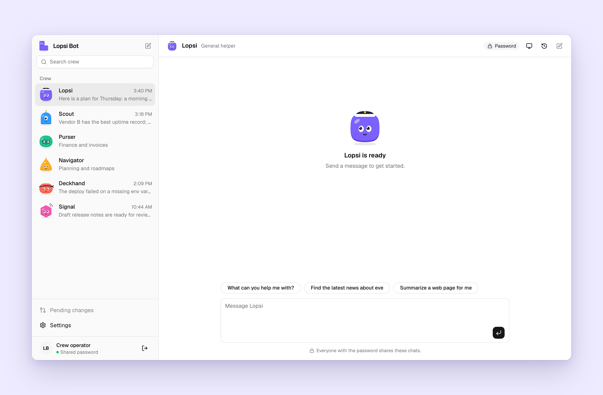

# Lopsi Bot

An [eve](https://eve.dev) template for Vercel: a crew of AI agents, each with its own instructions, tools and model, and the Lopsi Bot dashboard to talk to them.

**[Try the demo](https://lopsi-bot.vercel.app)**: an example crew with scripted replies, so no sign-in and no model.

     

## What you get

- **A crew of eve agents.** Each member is an eve agent under `agents/<name>/`, with a mascot, a role and its own chats. It starts with Lopsi; add more from the dashboard.
- **A dashboard to work with them.** Chat with tool runs, approvals and questions; a computer panel showing each chat's sandbox; chat history on every device with Sign in with Vercel; Settings.
- **Changes by pull request.** Edit a crew member's name, model, instructions, tools or connectors in the dashboard, and it opens a pull request. Nothing changes until you merge it.
- **Integrations.** Any service in [Vercel Connect](https://vercel.com/docs/connect) (Slack, Google, Stripe, Linear, Notion and the rest), added in Vercel and picked up without a redeploy. Chat with the crew in Slack or Telegram, and email it.
- **Safe by default.** A shared password to start, or Sign in with Vercel for your team. The shell has no network, and anything that changes something asks first.

## Deploy

[](https://vercel.com/new/clone?repository-url=https%3A%2F%2Fgithub.com%2Ffrankievalentine%2Flopsi-bot-eve&project-name=lopsi-bot&repository-name=lopsi-bot&env=LOPSI_ACCESS_PASSWORD%2CVERCEL_TOKEN&envDescription=LOPSI_ACCESS_PASSWORD%3A%20the%20password%20your%20crew%27s%20visitors%20enter%2C%20at%20least%2016%20characters%20%28openssl%20rand%20-base64%2032%29.%20VERCEL_TOKEN%3A%20a%20Vercel%20token%20scoped%20to%20this%20team%20%28not%20one%20project%29%2C%20so%20Lopsi%20can%20see%20the%20services%20you%20add%20in%20Vercel%20Connect.&envLink=https%3A%2F%2Fgithub.com%2Ffrankievalentine%2Flopsi-bot-eve%2Fblob%2Fmain%2Fdocs%2Fgetting-started.md%231-deploy&connect=%5B%7B%22type%22%3A%22github%22%2C%22env%22%3A%22GITHUB_CONNECTOR%22%7D%5D&stores=%5B%7B%22type%22%3A%22blob%22%2C%22access%22%3A%22private%22%7D%2C%7B%22type%22%3A%22integration%22%2C%22integrationSlug%22%3A%22upstash%22%2C%22productSlug%22%3A%22upstash-kv%22%2C%22protocol%22%3A%22storage%22%7D%5D)

The button clones this repository into your GitHub account and deploys it. It asks for:

- a password for [starter mode](docs/access.md#starter-mode);
- `VERCEL_TOKEN`, a [Vercel token](https://vercel.com/account/tokens) scoped to the team (not a single project), so Lopsi can see the services you add in Vercel Connect. Only the server reads it.

It also adds a GitHub App connector, so the dashboard can open pull requests (install the app on your new repository with contents and pull requests access), a private Blob store, and Upstash for Redis for email threads.

Then add services from the dashboard: Settings → **Integrations** → **Add Connectors** opens the project's Connect page. Anything you attach there shows up in Lopsi within a minute. See [Integrations](docs/integrations.md).

Email to the crew is a Resend connector too, turned on from its card in Settings ([Email](docs/integrations.md#email)). Only [Sign in with Vercel](docs/access.md#production-mode) for your team still runs from a clone of your repository linked to the project (`vercel link`): `pnpm setup:sign-in`.

## What it runs on

| For | It uses | Added by |
| --- | --- | --- |
| The crew's models | [AI Gateway](https://vercel.com/docs/ai-gateway) (the free tier works) | Nothing: the deployment's OIDC token |
| Dashboard pull requests | A [Vercel Connect](https://vercel.com/docs/connect) GitHub App connector | The Deploy button |
| Services, and chat in Slack or Telegram | [Vercel Connect](https://vercel.com/docs/connect) connectors, listed with `VERCEL_TOKEN` | You, in Vercel |
| Sign in with Vercel, private chats, chat history, workspace snapshots, approved hosts, sender allowlists, memory | A private [Vercel Blob](https://vercel.com/docs/vercel-blob) store | The Deploy button, or `pnpm setup:sign-in` |
| Email | [Upstash for Redis](https://vercel.com/marketplace/upstash), for conversation threads | The Deploy button |

## Stack

| | |
| --- | --- |
| Agents | [eve](https://eve.dev) (workspace layout, one agent per crew member), [Vercel Sandbox](https://vercel.com/docs/vercel-sandbox) for each chat's shell |
| Models | [AI SDK](https://ai-sdk.dev) through [AI Gateway](https://vercel.com/docs/ai-gateway) |
| Web app | [Next.js](https://nextjs.org) on [Vercel Services](https://vercel.com/docs/services) |
| Interface | Lopsi Bot's dashboard on [AI Elements](https://ai-sdk.dev/elements), [shadcn/ui](https://ui.shadcn.com) and [Base UI](https://base-ui.com), with Tailwind CSS |
| Sign-in | [Better Auth](https://better-auth.com) with Sign in with Vercel |
| Integrations | [Vercel Connect](https://vercel.com/docs/connect) for services, Slack and Telegram; the [Chat SDK](https://chat-sdk.dev) Resend adapter for email |
| Storage | [Vercel Blob](https://vercel.com/docs/vercel-blob), [Upstash for Redis](https://vercel.com/marketplace/upstash) |

## Documentation

- [docs/getting-started.md](docs/getting-started.md): from Deploy to a working crew, step by step.
- [docs/access.md](docs/access.md): starter mode and Sign in with Vercel, who can see a chat, what the crew can reach.
- [docs/integrations.md](docs/integrations.md): connectors, email and messaging channels.
- [docs/crew.md](docs/crew.md): adding crew members, Settings, changing the crew from the dashboard.
- [docs/development.md](docs/development.md): running locally and checks.
- [docs/updating.md](docs/updating.md): getting a newer version of the template.
- [docs/removing.md](docs/removing.md): pausing a project, or removing it and what setup made for it.
- [ARCHITECTURE.md](ARCHITECTURE.md): how it fits together, and the security model.

## License

Apache-2.0. See [LICENSE](LICENSE) and [NOTICE](NOTICE).
