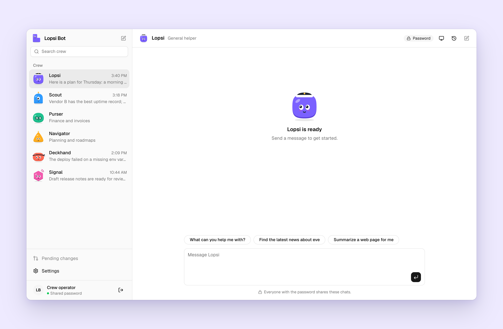

# Lopsi Bot for eve

An [eve](https://eve.dev) template for Vercel: a crew of AI agents, each with its own instructions, tools and model, and the Lopsi Bot dashboard to talk to them.

     

## What you get

- **A crew of eve agents.** Each member is an eve agent under `agents/<name>/`, with a mascot, a role and its own chats. It starts with Lopsi; add more from the dashboard.
- **A dashboard to work with them.** Chat with tool runs, approvals and questions; a computer panel showing each chat's sandbox; chat history on every device; Settings.
- **Changes by pull request.** Edit a crew member's name, model, instructions, tools or connectors in the dashboard, and it opens a pull request. Nothing changes until you merge it.
- **Integrations.** Connectors (Linear, Notion, Sentry, Resend, or any MCP service), email to and from the crew, and messaging channels (SMS, iMessage, WhatsApp and more).
- **Safe by default.** A shared password to start, or Sign in with Vercel for your team. The shell has no network, and anything that changes something asks first.

## Deploy

[](https://vercel.com/new/clone?repository-url=https%3A%2F%2Fgithub.com%2Ffrankievalentine%2Flopsi-bot-eve&project-name=lopsi-bot&repository-name=lopsi-bot&env=LOPSI_ACCESS_PASSWORD&envDescription=The%20password%20your%20crew%27s%20visitors%20enter.%20At%20least%2016%20characters%3B%20generate%20one%20with%3A%20openssl%20rand%20-base64%2032&envLink=https%3A%2F%2Fgithub.com%2Ffrankievalentine%2Flopsi-bot-eve%2Fblob%2Fmain%2Fdocs%2Faccess.md%23starter-mode&connect=%5B%7B%22type%22%3A%22github%22%2C%22env%22%3A%22GITHUB_CONNECTOR%22%7D%5D)

The button clones this repository into your GitHub account and deploys it. It asks for a password for [starter mode](docs/access.md#starter-mode) and adds a GitHub App connector so the dashboard can open pull requests; install the app on your new repository with contents and pull requests access.

Then add what you need, from a clone of your repository linked to the project (`vercel link`):

| Command | Adds |
| --- | --- |
| `pnpm setup:sign-in` | [Sign in with Vercel](docs/access.md#production-mode) for your team, one identity per person |
| `pnpm setup:connector <service>` | [Connectors](docs/integrations.md#connectors) |
| `pnpm setup:email` | [Email](docs/integrations.md#email) to and from the crew |
| `pnpm setup:channel <channel>` | [Messaging channels](docs/integrations.md#channels) |

## Documentation

- [Access](docs/access.md): starter mode and Sign in with Vercel, who can see a chat, what the crew can reach.
- [Integrations](docs/integrations.md): connectors, email and messaging channels.
- [The crew](docs/crew.md): adding members, Settings, changing the crew from the dashboard.
- [Development](docs/development.md): running locally, checks, tech stack.
- [Architecture](ARCHITECTURE.md): how it fits together, and the security model.

## License

Apache-2.0. See [LICENSE](LICENSE) and [NOTICE](NOTICE).
